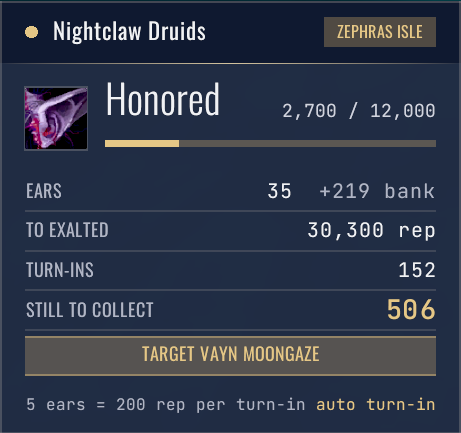

**Count your Al'Aketh Cultist's Ears against Exalted with the Nightclaw Druids, made for WoW Forever.**

The druids of Shadowgale Forest want ears, and a lot of them. Nightclaw Ears tells you how many you have, how many turn-ins are left and how many more ears you still need to collect, and hands them in for you when you talk to Vayn Moongaze.

**WoW Forever only** (interface 16001).

## Features

- **The whole picture in one panel.** Your standing and progress, ears in your bags and bank, rep to Exalted, turn-ins left, and ears still to collect.
- **Shows up when it's needed.** The panel opens when you arrive on Zephras Isle and closes when you leave. Open it yourself with `/ears` or the addon compartment and it stays open everywhere.
- **Auto turn-in.** Talk to Vayn Moongaze with enough ears and they go in by themselves: one right-click (or Interact key press) per turn-in. Hold Shift to skip it. It never picks a reward for you when there's a choice.
- **Target Vayn Moongaze button**, to pair with your Interact with Target key.
- **Learns the real numbers.** Ears per turn-in come from the turn-in window and rep from what you actually gain, so a change to the quest is picked up by itself.
- **A line on the ear's tooltip:** *Nightclaw Druids: 506 more ears to Exalted*.

## Commands

- `/ears`: show or hide the panel
- `/ears turnin`: auto turn-in on or off
- `/ears auto`: opening on Zephras Isle on or off
- `/ears lock`: lock or unlock the panel (drag to move)
- `/ears reset`: move the panel back to the middle
- `/ears minimap`: show or hide the minimap button
- `/ears options`: open the settings page

A **minimap button** shows or hides the panel (left-click) and opens the settings (right-click); drag it to move it. The **settings page** (Esc > Options > AddOns > Nightclaw Ears) has a tick for the button and for each switch above.

The addon can't start a conversation with Vayn for you: Blizzard only allows that from your own click or key binding.

Source and issues: [github.com/paradosi/NightclawEars](https://github.com/paradosi/NightclawEars)
