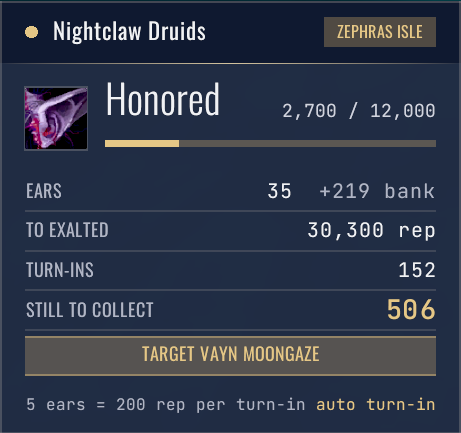

# Nightclaw Ears

A small **WoW Forever** addon for the Nightclaw Druids of Shadowgale Forest. It counts your
**Al'Aketh Cultist's Ears** and works out how many more the druids want before you're **Exalted**.

## What it shows

A movable panel. It **opens by itself when you arrive on Zephras Isle**, where the ears drop and the druids
live, and closes when you leave. Close it there and it stays closed until your next visit; open it yourself
(`/ears`, or the addon compartment button) and it stays open everywhere. Once you're Exalted it no longer
pops up. It shows:

- your Nightclaw Druids standing and progress through it
- ears in your bags (and in your bank, once you've opened it this session)
- rep left to Exalted, how many turn-ins that is, and how many ears you still have to collect

The ear's tooltip gets a line too: *Nightclaw Druids: 971 more ears to Exalted*.

## Turning in

**Talk to Vayn Moongaze and the ears go in by themselves.** With at least one turn-in's worth of ears in
your bags, the addon picks *More Al'Aketh Ears*, hands the ears in and takes the reward: one right-click on
Vayn per turn-in. It touches only that quest, never picks a reward for you when there's a choice, and
**holding Shift as you talk to him skips it** (or `/ears turnin` switches it off).

The **Target Vayn Moongaze** button (it reads his name from the turn-in window, so it follows your client's language) on the panel targets him, so your *Interact with Target* key (Key
Bindings → Targeting) can then talk to him.

> [!NOTE]
> The addon can't start the conversation for you. Talking to an NPC only works from your own click or a
> key binding: Blizzard blocks addons from doing it, and there is no `/interact` macro command.

> [!NOTE]
> The button is a secure (macro) button, so during combat the panel can't open, close or move: those
> wait until combat ends.

## How it counts

| | |
|---|---|
| Faction | Nightclaw Druids (2758). Exalted begins at 42,000 standing above Neutral |
| First quest | *Mercy Falls on Deaf Ears* (93165): 5 ears, 1,000 rep, once. Counted until you've done it |
| Repeatable | *More Al'Aketh Ears* (93459), Vayn Moongaze: 200 rep per turn-in |

The quest text says the repeatable takes 10 ears, but its objective data and Wowhead say 5, so the addon
starts at **5 ears = 200 rep** and corrects itself:

- **ears per turn-in** are read from the turn-in window when you talk to Vayn Moongaze
- **rep per turn-in** is read from the reputation you actually gain
- if a turn-in gives **no** reputation, the repeatable has a cap; the panel says at which standing

It prints a line when it learns either number, and after each turn-in.

## Commands

| | |
|---|---|
| `/ears` | show or hide the panel |
| `/ears turnin` | turn auto turn-in at Vayn Moongaze on or off |
| `/ears auto` | turn opening on Zephras Isle on or off |
| `/ears lock` | lock or unlock the panel (drag to move) |
| `/ears reset` | move the panel back to the middle |

Saved variables: `NightclawEarsDB` (account-wide: panel position, learned ears and rep per turn-in, whether it opens on Zephras Isle).

## Installation

Install it from [CurseForge](https://www.curseforge.com/projects/1827781) or
[Wago](https://addons.wago.io/addons/Q6aq7j6W) with their apps, or download the latest zip from
[GitHub Releases](https://github.com/paradosi/NightclawEars/releases) and extract it into `World of Warcraft\_forever_\Interface\AddOns\`, so you end up with
`AddOns\NightclawEars\NightclawEars.toc`. Restart the game (a newly added addon needs a restart, not just
`/reload`).

## Compatibility

| Client | Supported |
|---|---|
| WoW Forever (interface 16001) | yes |
| Retail, TBC Anniversary, Classic Era | no: the faction and quests exist only in Forever |

## Look and fonts

The panel follows [wowdb.dev](https://wowdb.dev)'s design: its colours, a hairline border, and its two
typefaces, shipped in `media/fonts`:

- **Oswald** (labels, standing), Copyright 2016 The Oswald Project Authors
- **JetBrains Mono** (numbers), Copyright 2020 The JetBrains Mono Project Authors

Both are under the SIL Open Font License 1.1; the licence texts are next to the fonts.

## Licence

The addon is MIT (see `LICENSE`). Oswald and JetBrains Mono are under the SIL Open Font License; their
licence files ship next to them in `media/fonts`.

> [!NOTE]
> Releases upload to CurseForge (project `1827781`) and Wago (`Q6aq7j6W`) from a `vX.Y.Z` tag, using the
> `## X-Curse-Project-ID:` and `## X-Wago-ID:` lines in the TOC and the repo's `CF_API_KEY` and
> `WAGO_API_TOKEN` secrets.
